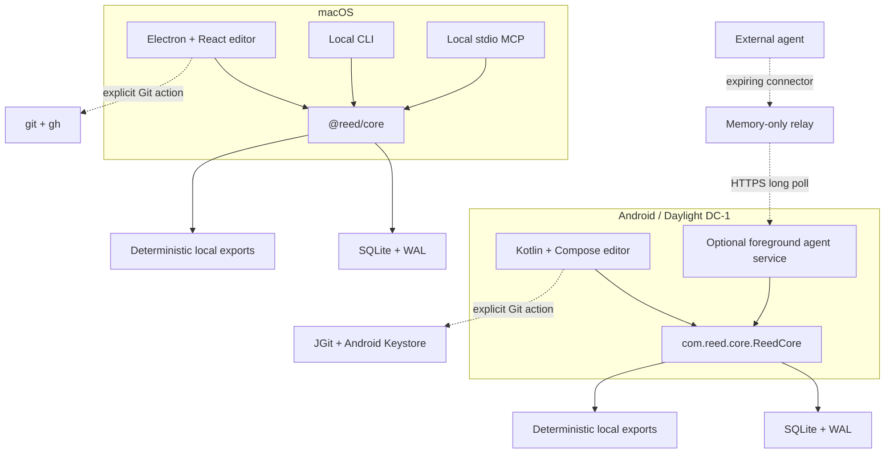

# Reed architecture

Reed is an offline-first authoring system with two application shells and one shared project contract. The macOS implementation is TypeScript/Electron; Android is Kotlin/Compose. Both keep SQLite in WAL mode as the canonical store and preserve the same permanent IDs, versioned mutations, production guardrails, and deterministic export semantics.

## System view

Solid lines are local calls. Dotted lines are optional network boundaries that require an explicit user action.

## Sources of truth

- A project's SQLite database is canonical.
- SQLite uses WAL mode for crash resilience and concurrent local readers.
- `exports/reed-project.json` is deterministic, reviewable output, not a second database.
- Unity/Pixel Crushers JSON is generated output and never imported back as canonical state.
- Line IDs and Pixel Crushers numeric mappings are permanent once allocated.
- Every mutation increments the project version and records history.
- Mutations accept `expectedVersion` where stale writes could overwrite newer work.

## Desktop implementation

`apps/editor` contains the Electron shell and React interface. The renderer has no raw filesystem, SQL, Git, or network authority; privileged operations cross the typed preload/IPC boundary and are implemented by the main process through `@reed/core`.

`packages/core` owns the TypeScript domain model, SQLite migrations, validation, history, backups, production rules, Git orchestration, and export generation. `packages/cli` and `apps/mcp` are thin clients over that core.

Desktop GitHub operations invoke bundled or system `git` and `gh`. GitHub CLI owns authentication through the operating-system credential store. Reed does not copy tokens into project files, preferences, SQLite, logs, or Git configuration.

## Android implementation

`apps/android/app` contains the Compose application, responsive workspace, input handling, and foreground agent service. `apps/android/core` is the Android implementation of the Reed snapshot and mutation contracts. It owns Room/SQLite access and platform-parity tests.

Android cannot rely on child-process Git, so `apps/android/git` uses JGit. A repository token is optional, encrypted through Android Keystore, and supplied to JGit only for the operation the user requested.

`apps/android/remote` implements the narrow Remote Agent Access transport. It is disabled by default, scoped to one open project, expires within 24 hours, and runs only as an Android foreground service with a persistent Disconnect action.

## Remote Agent Access boundary

The relay in `apps/relay` coordinates one tablet channel in process memory. It does not have a Reed account system, database, object store, durable queue, analytics pipeline, or LLM client. Restarting it drops active channels.

Remote tools may call guarded ReedCore operations. They cannot access Git, raw SQL, arbitrary files, shell execution, or credentials. Agents cannot promote text beyond `Polished`, mutate Final content, or bypass version conflicts and exact destructive confirmations.

See [Remote MCP from Claude Android](docs/REMOTE_MCP_ANDROID.md) for the deployment and threat model.

## Mutation and production invariants

- Final content is controlled by a person.
- Editing text with recorded-or-later voice status changes voice status to `Rework`.
- Destructive actions require confirmation or a reversible undo path.
- Agent mutations are recorded with an agent source and remain reviewable.
- English, Greek, Griko, Italian, and German remain valid UTF-8 across storage, UI, MCP, CLI, and exports.
- Node type, status, validation, and speaker identity are never communicated by color alone.

## Repository map

| Path | Responsibility |
|---|---|
| `apps/editor` | Electron main process, preload boundary, React UI, macOS packaging |
| `apps/android/app` | Compose UI, adaptive input, foreground remote-agent service |
| `apps/android/core` | Android SQLite model and mutation parity |
| `apps/android/git` | JGit transport and Keystore-backed credential handling |
| `apps/android/remote` | Relay protocol and connector capability storage |
| `apps/mcp` | Local stdio MCP entrypoint |
| `apps/relay` | Optional single-process, memory-only remote MCP relay |
| `packages/core` | TypeScript canonical domain, persistence, Git, backups, exports |
| `packages/schema` | Shared TypeScript contracts and schemas |
| `packages/cli` | Local command-line interface |

## Verification layers

1. TypeScript type checking for every workspace package.
2. Unit and regression tests for core, editor logic, Git/GitHub orchestration, relay behavior, and concurrency.
3. Android unit tests and parity tests, plus lint and APK assembly.
4. An offline smoke test covering core, CLI, MCP, backups, Git-disabled operation, Unicode exports, and the editor network boundary.
5. Manual DC-1 checks for touch, keyboard, mouse, trackpad, pen hover, background agent access, and lifecycle behavior.

Read [CONTRIBUTING.md](CONTRIBUTING.md) before changing a platform boundary.
