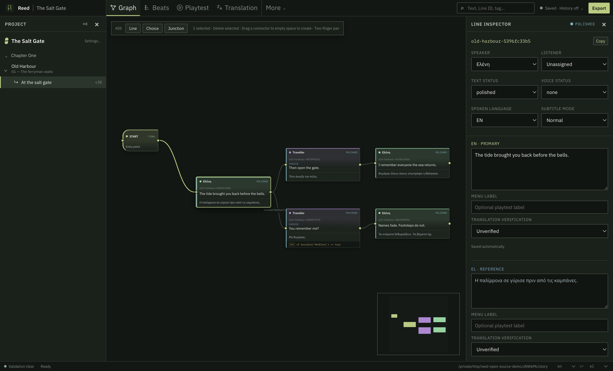
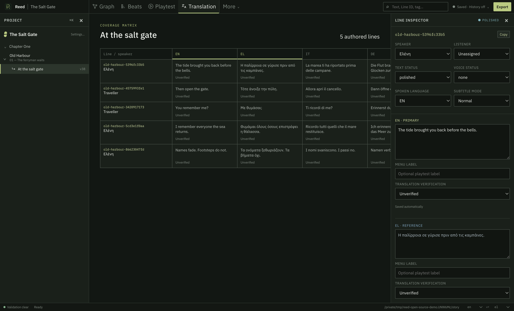

# Reed

<p align="center">
  
</p>

<p align="center">
  <strong>An offline-first narrative design and production workspace for branching games.</strong><br>
  Write the story, test the branches, prepare every language, and hand clean data to your game and performers.
</p>

<p align="center">
  <a href="https://github.com/is2b007/Reed/releases/latest"></a>
  <a href="https://github.com/is2b007/Reed/actions/workflows/ci.yml"></a>
  
  
  
  
</p>


Once a game conversation branches, it stops being “just dialogue.” A writer has to track who can say what, which choice reaches which consequence, what a variable changes, whether every path still works, which translation is missing, and what an actor needs to understand the line.

Reed keeps that work together. It is a visual writing room for narrative designers and indie game makers: graph the conversation, write and revise in context, play through choices, manage cast and variables, localize, prepare voice sessions, export to the rest of the production, and keep a recoverable history of the story.

Your project stays on your device. Opening, writing, saving, validating, backing up, playtesting, and exporting do not require an account or an internet connection.

## Download Reed

The current installable release is **Reed 0.1.9**. Reed 0.2.0 source is now on `main`; its downloads will be published only after the macOS and Windows packages pass the new release-signing gates.

| Platform | Download | Notes |
|---|---|---|
| macOS Apple silicon | [DMG](https://github.com/is2b007/Reed/releases/download/v0.1.9/Reed-0.1.9-arm64.dmg) · [ZIP](https://github.com/is2b007/Reed/releases/download/v0.1.9/Reed-darwin-arm64-0.1.9.zip) | Locally signed but not Apple-notarized; macOS may ask you to Control-click and choose **Open**. |
| Windows 10/11 x64 | [ZIP](https://github.com/is2b007/Reed/releases/download/v0.1.9/Reed-win32-x64-0.1.9.zip) | Not yet Authenticode-signed; Windows SmartScreen may ask for confirmation. |
| Android 13+ | [APK](https://github.com/is2b007/Reed/releases/download/v0.1.9/Reed-android-0.1.9-debug.apk) | Development-signed sideload build for tablets, tested on the Daylight DC-1. It cannot upgrade over the forthcoming release-signed build. |

[Release notes, checksums, and previous versions](https://github.com/is2b007/Reed/releases)

Reed is free and open source. If it helps your game, you can optionally support its continued development on [itch.io](https://maniadesign.itch.io/reed); downloading and using Reed never requires a payment, account, or license key.

> [!IMPORTANT]
> Reed is pre-1.0 software. Keep project backups and verify generated output against the exact engine, localization, and production toolchain used by your game before shipping.

## Built around the way narrative work grows

### Start with beats, scenes, and conversations

Organize a project into levels, scenes, conversations, and beats instead of one enormous graph. Keep an external beat or design reference beside the scene, see the shape of the story in the Beats workspace, and move between structure and individual lines without losing where you are.

### Write branching dialogue visually

- Create **Line**, **Choice**, and **Junction** nodes directly on the canvas.
- Drag from a node’s connector to another node, or drop on empty space and choose what to create there.
- Move nodes live, marquee-select a group, reposition several at once, and confirm destructive deletion.
- Pan with a trackpad, touch, or Space-drag; zoom around the cursor or pinch midpoint.
- Follow links across conversations while permanent Line IDs keep every authored line stable.
- Distinguish speakers with character accents while labels and icons preserve meaning without relying on color alone.

### Give every line the context it needs

A line can carry more than words. Reed keeps the speaker and listener, separate spoken and choice-menu text, conditions, scripts, sequences, tags, status, story context, pronunciation, performance direction, and an authored context path together in the inspector.

Characters have descriptions, localized display names, actor notes, and voice/accent notes. Variables have declared types, initial values, descriptions, and usage counts, so a writer can understand what a condition means without searching code.

### Read it and play it before someone implements it

- **Playtest** walks the graph as a player would, shows choices, evaluates local condition values, and keeps the path history visible.
- **Read** turns the current conversation into a clean linear reading view.
- **Validation** finds orphan nodes, dead ends, missing translations, unknown speakers, undeclared variables, stale drafts, and export-ID collisions.
- **Search** finds text, Line IDs, characters, tags, statuses, and language coverage across the project.
- **Review** compares work against an approved snapshot before the next narrative milestone is accepted.

### Localize without flattening the story into a spreadsheet

Choose from 47 ready-to-use game languages, apply a game-market preset, or add a custom BCP 47 language tag. Write two languages side by side, keep spoken dialogue separate from player-facing menu text, filter by coverage and verification, and see exactly which branch still needs attention.

Greek, Griko, Italian, German, English, Arabic, Hebrew, CJK scripts, Cyrillic, accented Latin text, and right-to-left language identity remain Unicode from the editor through every export.

### Prepare material that actors and studios can actually use

Reed’s voice package is a recording-room handoff, not a database dump:

- a studio/director PDF with cast totals, story context, direction, dialogue, Line IDs, and exact WAV filenames;
- one focused PDF per actor with character notes, nearby lines, and writable take/pickup space;
- an XLSX recording tracker with frozen identity columns, filters, take state, pickup state, and studio notes;
- UTF-8 CSV for DAWs, renaming tools, and custom pipelines;
- line, word, and estimated read-time totals before export.

Select the exact recording language and export the whole cast, one character, ready-to-record lines, or pickups. Reed stops rather than silently substituting another language. If recorded dialogue changes later, its voice status automatically becomes **Rework**.

### Keep the story recoverable

Every completed edit autosaves to the local SQLite project. Reed also provides rolling and named database backups, deterministic project JSON, review snapshots, and optional local Git checkpoints. **Saved** means the database is current; a checkpoint is a separate named story milestone.

GitHub collaboration is optional per project and managed inside Reed. From **Saved** or **History**, a team can connect or create a repository, fetch, push a clean branch, open a pull request, review it, and merge it. Reed never performs background sync or asks a writer to manage routine project versioning in a terminal.

### Bring your own writing or coding agent

Reed ships a local CLI and stdio MCP server over the same guarded project core as the editor. An external agent can inspect structure, find lines, validate, create and connect nodes, update dialogue, manage cast and variables, and produce exports without touching SQLite directly.

Reed does not contain an LLM client, model account, prompt service, or hidden Git publisher. Agent-authored text cannot advance beyond **Polished**; **Edited** and **Final** remain human-controlled. On Android, Remote Agent Access is an explicit, expiring foreground session scoped to one project.

## See the work, not just the graph

<table>
  <tr>
    <td width="50%">
      
      <br><strong>Graph authoring</strong><br>
      Branching nodes, cast accents, permanent Line IDs, variables, validation, and a contextual inspector in one production workspace.
    </td>
    <td width="50%">
      
      <br><strong>Translation coverage</strong><br>
      Compare authored languages side by side and keep each translation connected to its speaker, choice, branch, and review status.
    </td>
  </tr>
</table>

The screenshots use the disposable demo project created by [`scripts/create-demo.mjs`](scripts/create-demo.mjs). They contain no private production data.

## A practical writer’s workflow

1. **Create the project.** Name the game, choose its writing and target languages, then add the cast and story variables.
2. **Map the dramatic shape.** Create levels, scenes, beats, and conversations; keep design references with the scene.
3. **Write the first playable pass.** Add lines and choices, connect branches, use junctions to converge them, and add conditions where state matters.
4. **Read and play every route.** Catch awkward transitions, impossible choices, dead ends, and missing context before the dialogue reaches code.
5. **Revise with production metadata.** Add tags, pronunciation, performance direction, statuses, and stable IDs without duplicating the prose elsewhere.
6. **Translate in context.** Work beside the source language, filter incomplete or unverified lines, and preserve separate choice-menu wording.
7. **Prepare review or recording.** Approve a snapshot, export actor/studio packets, and use permanent Line IDs as audio filenames.
8. **Hand off the game data.** Export the format your engine or localization pipeline expects, then checkpoint and optionally open a pull request.

## Exports for games and production

Every export stays local and uses permanent Reed Line IDs as keys.

| Export | What it is for |
|---|---|
| Reed project JSON | Complete deterministic, Git-readable story snapshot for custom pipelines and review. |
| Unity Localization CSV | String Table Collection-style rows with stable IDs, comments, and locale columns. |
| Godot localization CSV | UTF-8 `keys` plus locale columns and human-readable context columns. |
| Unreal String Tables | One CSV per culture with source strings and contextual metadata. |
| Yarn Spinner strings | One localization CSV per language using Yarn’s line/string layout. |
| GNU gettext PO | Version-control-friendly catalogs for gettext tooling and compatible engines. |
| XLIFF 2.0 | Bilingual CAT-tool/vendor handoff with source, target, context, and Line ID notes. |
| Plain JSON and CSV | Engine-neutral formats for spreadsheets, scripts, databases, and custom runtimes. |
| Pixel Crushers Dialogue Database | Optional full-graph Unity export with actors, variables, conditions, scripts, localization, stable numeric mappings, and audio manifests. |
| Screenplay Markdown | A readable narrative handoff outside the graph. |
| Voice PDF, XLSX, and CSV | Actor packets, studio master, recording tracker, budgets, context, and filename manifest. |

The Unity, Godot, Unreal, Yarn, PO, XLIFF, JSON, and CSV adapters are localization/string interchange formats. Reed’s deterministic project JSON is the portable complete graph. The Pixel Crushers adapter is a deeper, one-way graph integration and should be verified against the exact plugin version used by the game.

Read [languages and game exports](docs/LOCALIZATION_EXPORTS.md), [voice production](docs/VOICE_PRODUCTION.md), and the [Pixel Crushers compatibility checklist](docs/PIXEL_CRUSHERS.md).

## Desktop, tablet, keyboard, mouse, touch, and pen

| | macOS | Windows | Android / Daylight DC-1 |
|---|---|---|---|
| Current target | Apple silicon | Windows 10/11 x64 | Android 13+; tested on Daylight DC-1 |
| Input | Keyboard, mouse, trackpad | Keyboard, mouse, precision touchpad | Touch, keyboard, mouse, trackpad, Wacom EMR pen |
| Canvas | Live drag, marquee, connector drop-to-create, focal zoom, Space/trackpad pan | Same desktop graph interactions | Collapsible panes, pen hover, barrel-button marquee, connector drag, two-finger pan, focal pinch zoom |
| Git | Local Git and optional in-app GitHub/PR workspace | Local Git and optional in-app GitHub/PR workspace | Embedded JGit and optional Android Keystore token |
| External agents | Local stdio MCP or CLI | Local stdio MCP or CLI | Explicit foreground Remote Agent Access session |
| Offline default | Yes | Yes | Yes |

The interface also includes recent projects, project settings, keyboard workspace shortcuts, a command palette, responsive/collapsible project and inspector panes, and Automatic, Light, and Dark appearance modes.

## Offline by design

SQLite in WAL mode is the canonical source of truth. Reed has no account, telemetry, hosted project store, cloud configuration, update checker, remote fonts/assets, or embedded LLM.

The only network boundaries are actions a person explicitly starts:

1. a labelled Git or GitHub action after collaboration is enabled for that project; or
2. a time-limited Android Remote Agent Access session with a persistent Disconnect notification.

Turning those features off leaves a complete local writing, playtesting, localization, backup, and export workflow. See the automated [offline contract](docs/OFFLINE_CONTRACT.md).

## Project data

```text
my-story/
  .reed/
    reed.sqlite       canonical database
    reed.sqlite-wal   write-ahead log while the project is open
    backups/          rolling and named SQLite snapshots
  exports/
    reed-project.json deterministic review and integration snapshot
    integrations/     engine and localization-tool handoffs
    voice/            studio and actor packages
    screenplay.md
```

Generated exports are outputs, not a second source of truth. Make story changes in Reed and export again. Every mutation increments the project version, records history, and supports optimistic concurrency where another editor or agent could be working from an older version.

## Build from source

Requirements:

- Node.js `>=22.22.0`
- pnpm `11.8.0`
- JDK 21 and Android SDK API 36 for Android
- macOS Apple silicon for the current Mac package

```sh
git clone https://github.com/is2b007/Reed.git
cd Reed
corepack enable
pnpm install --frozen-lockfile
pnpm typecheck
pnpm exec vitest run --no-file-parallelism --maxWorkers=1
pnpm test:offline
pnpm desktop:make:mac
pnpm desktop:make:windows
```

For Android:

```sh
pnpm android:test
pnpm android:lint
pnpm android:build
adb install -r apps/android/app/build/outputs/apk/debug/app-debug.apk
```

`adb install -r` preserves existing app data. Do not run connected Android tests on a device that contains the only copy of a project; the connected-test lifecycle can replace the package and clear local data.

## CLI and MCP

Create and inspect a project without opening the editor:

```sh
pnpm reed init ./my-story \
  --name "My Story" \
  --slug my-story \
  --languages en,el,it,de,griko \
  --default-language en

pnpm reed --project ./my-story add-scene "Opening" --slug opening
pnpm reed --project ./my-story --help
```

Build the local MCP runtime and point an MCP-compatible agent at one project:

```sh
pnpm build:runtime
node /absolute/path/to/Reed/apps/mcp/dist/index.js \
  --project /absolute/path/to/my-story
```

Start with [MCP setup](docs/MCP_SETUP.md), the [AI playbook](docs/AI_MCP_PLAYBOOK.md), or [Remote MCP from Claude Android](docs/REMOTE_MCP_ANDROID.md).

## Repository map

```text
apps/
  editor/   macOS and Windows desktop application
  android/  native Android application and platform core
  mcp/      local stdio MCP entrypoint
  relay/    optional memory-only Android connector relay
packages/
  core/     canonical TypeScript domain and persistence rules
  schema/   shared graph and tool contracts
  cli/      local command-line interface
docs/       product, platform, integration, and production guides
scripts/    offline verification, demo, and relay operations
```

## Documentation

| Start here | Purpose |
|---|---|
| [Product brief](docs/PRODUCT_BRIEF.md) | Product goals, users, and scope |
| [Editor design](docs/EDITOR_DESIGN.md) | Workspace behavior and interaction rationale |
| [Architecture](ARCHITECTURE.md) | Components, sources of truth, and network boundaries |
| [Data model](docs/DATA_MODEL.md) | Project hierarchy, IDs, versions, and graph records |
| [Languages and game exports](docs/LOCALIZATION_EXPORTS.md) | Language catalog and every engine/interchange format |
| [Voice production](docs/VOICE_PRODUCTION.md) | Actor and studio workflow |
| [Project history](docs/PROJECT_HISTORY.md) | Backups, local Git, optional GitHub, and pull requests |
| [Android / DC-1](docs/ANDROID_DC1.md) | Build, install, input, Git, and device verification |
| [MCP setup](docs/MCP_SETUP.md) | Configuration for humans and AI coding tools |
| [AI MCP playbook](docs/AI_MCP_PLAYBOOK.md) | Safe agent operating sequence |
| [Offline contract](docs/OFFLINE_CONTRACT.md) | Allowed networking and release acceptance |
| [Contributing](CONTRIBUTING.md) | Development setup, test tiers, and platform guardrails |

## Contributing and license

Contributions are welcome once the repository is made public. Read [CONTRIBUTING.md](CONTRIBUTING.md), follow the [Code of Conduct](CODE_OF_CONDUCT.md), and use the issue forms for reproducible bugs or bounded proposals. Security-sensitive reports belong in [GitHub’s private vulnerability report](https://github.com/is2b007/Reed/security/advisories/new), not a public issue.

Reed is open source under the [Mozilla Public License 2.0](LICENSE). You may use Reed to create commercial or non-commercial games; your game, story, project files, and exports are yours and are not covered by Reed's source-code license. If you distribute modified Reed source files, the MPL requires those files to remain available under the MPL. Reed's name and logo are not licensed as trademarks. Runtime dependency licenses are recorded in [Third-party notices](THIRD_PARTY_NOTICES.md).
