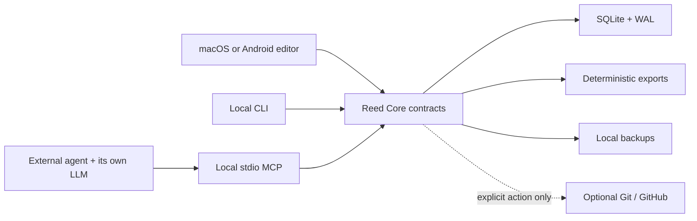

# Reed

<p align="center">
  
</p>

<p align="center">
  <strong>An offline-first branching dialogue workstation for Unity and Pixel Crushers.</strong><br>
  Write, localize, review, playtest, version, and export a story from macOS or an Android tablet.
</p>

<p align="center">
  <a href="https://github.com/is2b007/Reed/actions/workflows/ci.yml"></a>
  
  
  
  
</p>


Reed is built for narrative teams working on branching, multilingual dialogue. SQLite is the source of truth; the graph, production metadata, history, backups, agent tools, and exports remain available with no network connection. There is no Reed account, telemetry, cloud project store, hosted feature flag, updater, or embedded LLM.

Optional Git and GitHub collaboration is disabled per project until the author enables it. Android's Remote Agent Access is a separate, explicit, expiring session that exposes only guarded Reed tools to an external agent.

> [!IMPORTANT]
> Reed is pre-1.0 software. Keep project backups and verify Pixel Crushers output against the Unity/plugin versions used by your production before shipping a game.

## See Reed

<table>
  <tr>
    <td width="50%">
      
      <br><strong>Graph authoring</strong><br>
      Dense node editing, character accents, permanent Line IDs, variables, validation, and a contextual inspector.
    </td>
    <td width="50%">
      
      <br><strong>Translation coverage</strong><br>
      English, Greek, Italian, German, and Griko remain visible as authored text, not flattened export data.
    </td>
  </tr>
</table>

The screenshots use the disposable demo project created by [`scripts/create-demo.mjs`](scripts/create-demo.mjs). They contain no private production data.

## What Reed includes

- A visual graph for line, choice, junction, and cross-conversation flow, with direct connector dragging and create-on-drop.
- Permanent Line IDs, stable Pixel Crushers numeric mappings, conditions, Lua, sequences, tags, variables, cast metadata, and voice context.
- Side-by-side languages, translation coverage, local validation, read view, text-only playtest, beat map, review snapshots, and search.
- Autosave with a visible state, SQLite/WAL history, rolling and named backups, deterministic JSON, and reversible or confirmed destructive actions.
- Voice-actor PDFs, studio XLSX/CSV, screenplay Markdown, word/minute budgets, audio manifests, and Pixel Crushers JSON.
- Optional local Git checkpoints, branches, GitHub sync, and pull-request review from inside Reed.
- A local stdio MCP server and CLI backed by the same versioned core contracts as the editor.

## macOS and Android

Reed has two native application shells over equivalent project rules.

| | macOS | Android / Daylight DC-1 |
|---|---|---|
| Interface | Electron, React, and React Flow | Kotlin and Jetpack Compose |
| Current target | Apple silicon | Android 13+; tested on Daylight DC-1 |
| Storage | `@reed/core`, SQLite in WAL mode | Android `ReedCore`, SQLite in WAL mode |
| Input | Keyboard, mouse, and trackpad | Touch, hardware keyboard, mouse, trackpad, and Wacom EMR pen |
| Canvas | Marquee select, live node drag, connector drop-to-create, trackpad pan, focal zoom | Responsive panes, pen hover, side-button marquee, connector drag, two-finger pan, focal pinch zoom |
| Git | Bundled/system `git` and GitHub CLI credential store | Embedded JGit and optional Android Keystore token |
| External agents | Local stdio MCP or CLI | Explicit foreground Remote Agent Access session |
| Offline default | Yes | Yes |

### macOS

Download the latest Apple-silicon build from [GitHub Releases](https://github.com/is2b007/Reed/releases/latest), or build from source below. Published binary releases currently trail the active source tree, so contributors testing the newest Android, GitHub, and remote-agent work should build from `main`.

The current development app is locally signed but not Apple-notarized. If macOS blocks it, Control-click **Reed.app**, choose **Open**, and confirm once. Intel macOS, Windows, and Linux packages are not currently produced.

Build a local application bundle:

```sh
pnpm install --frozen-lockfile
CI=true pnpm typecheck
CI=true pnpm exec vitest run --no-file-parallelism --maxWorkers=1
CI=true pnpm test:offline
CI=true pnpm --filter @reed/editor package
```

The application is written to `apps/editor/out/Reed-darwin-arm64/Reed.app`.

### Android and Daylight DC-1

The Android application is optimized for the DC-1's compact grayscale display without becoming device-specific. It supports rotation and split screen, collapsible navigator and inspector panes, keyboard focus, mouse hover, two-finger trackpad pan, pinch zoom around the finger midpoint, pen hover, barrel-button marquee selection, and direct output-port linking.

Build with JDK 21 and Android SDK API 36:

```sh
export JAVA_HOME=/path/to/jdk-21
pnpm android:test
pnpm android:lint
pnpm android:build
adb install -r apps/android/app/build/outputs/apk/debug/app-debug.apk
```

`adb install -r` preserves existing app data. Do not run connected Android tests on a device that contains the only copy of a project; Reed requires an explicit `-PallowDeviceDataReset=true` opt-in because Android's connected-test lifecycle can replace the package and clear local data.

Read [Android and Daylight DC-1 setup](docs/ANDROID_DC1.md) and the [Android architecture and parity contract](docs/ANDROID_ARCHITECTURE.md).

## Offline by design



Opening Reed, opening a project, editing, saving, validating, backing up, and exporting do not start a network process. The two narrow exceptions are:

1. a labelled Git/GitHub action after collaboration is enabled for that project; and
2. an explicit Android Remote Agent Access session, scoped to one project and limited to 24 hours or less.

See the testable [offline contract](docs/OFFLINE_CONTRACT.md).

## Quick start from source

Requirements:

- Node.js `>=22.22.0`
- pnpm `11.8.0`
- JDK 21 and Android SDK API 36 only if building Android
- macOS on Apple silicon only if packaging the desktop app

```sh
git clone https://github.com/is2b007/Reed.git
cd Reed
corepack enable
pnpm install --frozen-lockfile
pnpm typecheck
pnpm exec vitest run --no-file-parallelism --maxWorkers=1
pnpm test:offline
```

Create a project from Reed's welcome screen, or use the CLI:

```sh
pnpm reed init ./my-story \
  --name "My Story" \
  --slug my-story \
  --languages en,el,it,de,griko \
  --default-language en

pnpm reed --project ./my-story add-scene "Opening" --slug opening
pnpm reed --project ./my-story --help
```

## Project files and Unity export

SQLite is canonical. A Reed project contains:

```text
my-story/
  .reed/
    reed.sqlite       canonical database
    reed.sqlite-wal   write-ahead log while open
    backups/          rolling and named SQLite snapshots
  exports/
    reed-project.json deterministic Git-readable snapshot
    pixel-crushers/   Unity JSON and audio manifests
    voice/            studio and actor handoff files
    screenplay.md
```

Unity JSON is one-way generated output stamped `GENERATED — DO NOT HAND-EDIT`. Make canonical changes in Reed and export again. The exporter has automated coverage for stable IDs, localized fields, Base ID collision prevention, cross-links, Unicode, and manifests, but still needs a real Unity-authored fixture before any Unity/Pixel Crushers version is called certified.

Read the [Pixel Crushers compatibility checklist](docs/PIXEL_CRUSHERS.md).

## MCP and external agents

Build the runtime packages, then configure an MCP-compatible desktop agent to start Reed over stdio:

```sh
pnpm build:runtime
node /absolute/path/to/Reed/apps/mcp/dist/index.js \
  --project /absolute/path/to/my-story
```

Reed does not contain an LLM client. Agents use their own model connection and reach the same mutation APIs as the CLI and editor. Agent-authored text cannot be promoted above `Polished`; `Final` remains human-controlled.

On Android, Remote Agent Access is deliberately different: Reed starts a foreground service with a persistent Disconnect notification and creates an expiring connector through a memory-only relay. It exposes no Git, raw SQL, arbitrary files, shell, or LLM client. Read [Remote MCP from Claude Android](docs/REMOTE_MCP_ANDROID.md).

## Repository map

```text
apps/
  editor/   macOS Electron application
  android/  native Android application and platform core
  mcp/      local stdio MCP entrypoint
  relay/    optional memory-only Android connector relay
packages/
  core/     canonical TypeScript domain and persistence rules
  schema/   shared graph and tool contracts
  cli/      local command-line interface
docs/       product, platform, integration, and production guides
scripts/    offline verification, demo, and relay operations
```

The platform-level view is in [ARCHITECTURE.md](ARCHITECTURE.md).

## Documentation

| Start here | Purpose |
|---|---|
| [Contributing](CONTRIBUTING.md) | Development setup, test tiers, pull requests, and platform guardrails |
| [Architecture](ARCHITECTURE.md) | Components, sources of truth, and network boundaries |
| [Data model](docs/DATA_MODEL.md) | Project hierarchy, IDs, versions, and graph records |
| [CLI reference](docs/CLI.md) | Scriptable local workflows |
| [MCP reference](docs/MCP.md) | Local agent tool contract |
| [MCP setup](docs/MCP_SETUP.md) | Configuration for humans and AI coding tools |
| [AI MCP playbook](docs/AI_MCP_PLAYBOOK.md) | Safe agent operating sequence |
| [Project history](docs/PROJECT_HISTORY.md) | Backups, local Git, optional GitHub, and pull requests |
| [Voice production](docs/VOICE_PRODUCTION.md) | Actor and studio export workflow |
| [Offline contract](docs/OFFLINE_CONTRACT.md) | Allowed networking and release acceptance |
| [Android / DC-1](docs/ANDROID_DC1.md) | Build, install, input, Git, and device verification |
| [Remote Android MCP](docs/REMOTE_MCP_ANDROID.md) | Claude connector model and relay deployment |
| [Pixel Crushers](docs/PIXEL_CRUSHERS.md) | Export shape, Unity import, and certification boundary |
| [Product brief](docs/PRODUCT_BRIEF.md) | Product goals, users, and scope |
| [Build plan](docs/BUILD_PLAN.md) | Delivery architecture and completion sequence |
| [Editor design](docs/EDITOR_DESIGN.md) | Workspace behavior and interaction rationale |
| [Visual references](docs/VISUAL_REFERENCES.md) | Source research and Reed-specific takeaways |
| [Design system](DESIGN.md) | Reed's industrial-editorial interface rules |

## Contributing and community

Contributions are welcome once the repository is made public. Start with [CONTRIBUTING.md](CONTRIBUTING.md), follow the [Code of Conduct](CODE_OF_CONDUCT.md), and use the issue forms for reproducible bugs or bounded proposals. Security-sensitive reports belong in [GitHub's private vulnerability report](https://github.com/is2b007/Reed/security/advisories/new), not a public issue.

The [open-source launch checklist](docs/OPEN_SOURCE_CHECKLIST.md) records the remaining repository-owner decisions and GitHub settings.

## License

No open-source license has been selected yet. Until a `LICENSE` file is added, copyright law applies and the source is not licensed for reuse or redistribution. Choosing a license is the final legal blocker before making this repository public.
